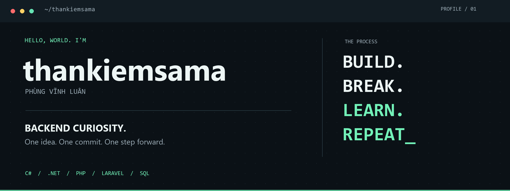

  

<h1 align="center">Phùng Vĩnh Luân</h1>

<strong>Fresher .NET Backend Developer</strong> APIs · Business logic · Relational databases · Testing

  <a href="https://github.com/thankiemsama?tab=repositories"><strong>Explore my code ↗</strong></a>
  &nbsp; · &nbsp;
  <a href="#selected-projects"><strong>Selected projects ↓</strong></a>

---

### 01 / About me

I'm **Luân**, an Information Technology graduate from **HUIT (2025)**, focused on **C# and .NET backend development**.

Through internships and team projects, I've contributed to REST APIs, database design, application maintenance and React API integration. I enjoy working on the details behind a useful feature: who can access it, how its data stays consistent, and what happens when a request fails or arrives twice.

### 02 / My toolkit

| Area | Technologies & practices |
| :--- | :--- |
| **Backend** | C# · ASP.NET Core Web API · Entity Framework Core · ASP.NET Framework |
| **Databases** | SQL Server · MySQL · Relationships, constraints & transactions |
| **Web** | React · JavaScript · TypeScript · HTML · CSS · PHP / Laravel |
| **Quality & collaboration** | xUnit · Test cases & manual testing · Git / GitHub · Postman · Swagger |

### 03 / Selected projects

These are **team projects I contributed to**, with continued improvements after their initial development. My forks bring that shared work together in my portfolio; the original repositories and contributor history remain available in each repository.

<table>
<tr><td>
<h3>01 &nbsp; Badminton Booking</h3>

<strong>C# · ASP.NET Core 8 · EF Core · SQL Server · xUnit</strong>

A court booking application with availability, reservations, payments and cancellation/refund workflows.

<ul>
<li><strong>Booking consistency:</strong> database constraints and transactions protect against conflicting court reservations.</li>
<li><strong>Payment reliability:</strong> repeated callbacks do not apply the same payment update twice; gateway adapters have mock/stub tests.</li>
<li><strong>Verification:</strong> xUnit scenarios cover concurrent bookings, refunds, vouchers and callback replays.</li>
</ul>

<a href="https://github.com/thankiemsama/Badminton"><strong>Explore repository ↗</strong></a> &nbsp; · &nbsp; <a href="https://badminton-bvqs.onrender.com/">Demo ↗</a>

</td></tr>
<tr><td>
<h3>02 &nbsp; Marixa — Attendance & HR</h3>

<strong>C# · ASP.NET Core · EF Core · React</strong>

An employee management application covering check-in/out, leave requests and HR reports.

<ul>
<li><strong>Access control:</strong> JWT authentication and role-based permissions protect employee data and approval actions.</li>
<li><strong>Connected workflows:</strong> REST APIs connect the backend business logic with React interfaces.</li>
<li><strong>Team contribution:</strong> API development/integration, test cases, manual testing and defect verification.</li>
</ul>

<a href="https://github.com/thankiemsama/ChamCong"><strong>Explore repository ↗</strong></a> &nbsp; · &nbsp; <a href="https://marixa001.vercel.app/">Demo ↗</a>

</td></tr>
<tr><td>
<h3>03 &nbsp; Web Attendance</h3>

<strong>PHP / Laravel · MySQL · React · TypeScript</strong>

A student attendance system originally built with PHP/MySQL and later upgraded by the team to a Laravel API and React frontend.

<ul>
<li><strong>Classroom workflows:</strong> class/student management, role-based access and attendance reports.</li>
<li><strong>QR attendance:</strong> expiring check-in tokens, duplicate attendance prevention and an audit history for manual corrections.</li>
<li><strong>Engineering:</strong> relational database design, frontend API integration and backend/frontend automated tests.</li>
</ul>

<a href="https://github.com/thankiemsama/WebAttendance"><strong>Explore repository ↗</strong></a> &nbsp; · &nbsp; <a href="https://attendanceweb-psi.vercel.app/">Demo ↗</a>

</td></tr>
</table>

### 04 / What I'm looking for

I'm looking for a **Fresher .NET / Backend Developer** opportunity where I can contribute to APIs and business applications, learn through code reviews, and keep improving my testing and database skills.

Build something useful. Understand how it works. Make it better.

